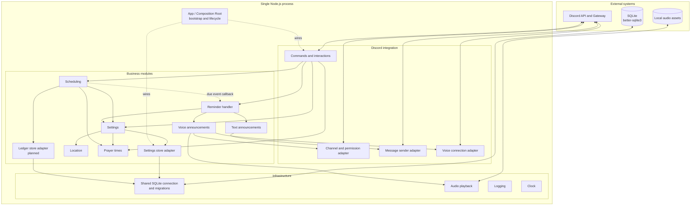
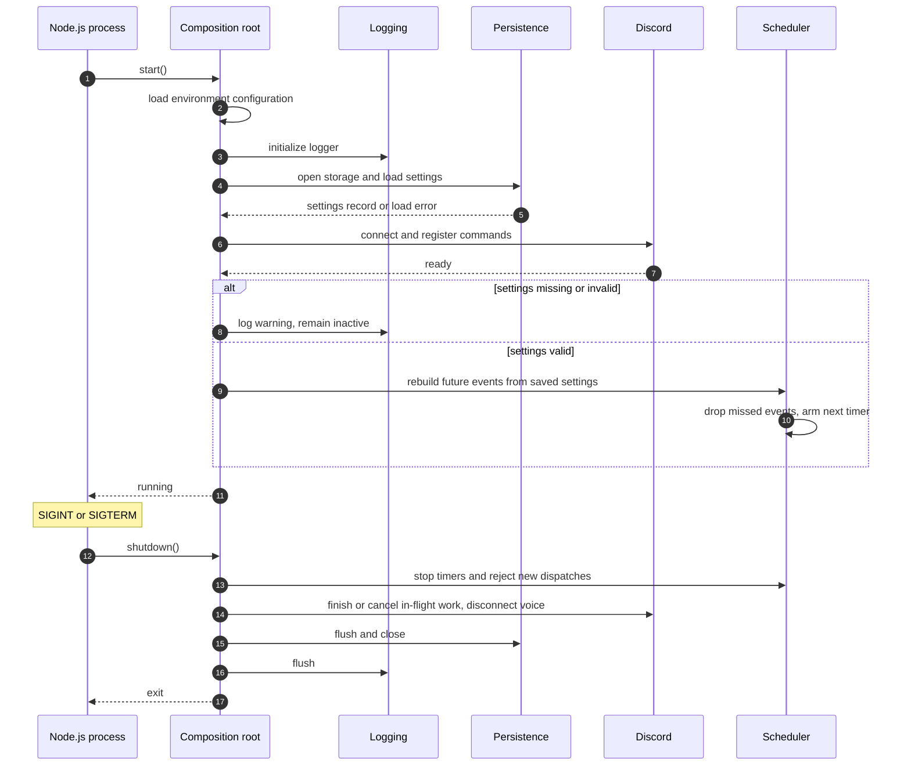

# Mudhakkir — System Architecture

This document describes the proposed runtime and module architecture for Mudhakkir's initial release. It is an implementation design, not a product specification. Product behavior remains defined by the [requirements](../product/requirements.md) and [business rules](../product/business-rules.md).

Status labels follow the [documentation index](../README.md#status-labels). The **Confirmed** constraints below are inherited from the project documentation. Module names, boundaries, directory names, and internal mechanisms are **Proposed** unless explicitly marked otherwise. **Open** questions must not be implemented as though they were settled.

Related documents:

- [Code structure](code-structure.md) — proposed source layout and enforceable architecture rules.
- [Requirements](../product/requirements.md) — required behavior and the consolidated open product decisions.
- [Business rules](../product/business-rules.md) — event, eligibility, independence, and scheduling rules.
- [Command specification](../product/command-specification.md) — proposed command behavior.

## 1. Architectural constraints

| Constraint | Status | Consequence |
| --- | --- | --- |
| One Discord server initially | Confirmed | No multi-tenant orchestration is needed; multi-server operation is **Future**. |
| Guild-scoped data model | **Proposed** | Records are keyed by guild ID even in the single-server release, so multi-server support does not require a data migration. |
| One bot instance, one Node.js process | Confirmed | A single scheduler loop and in-process coordination are sufficient. |
| TypeScript compiled to JavaScript | Confirmed | Source is TypeScript; build output is JavaScript. |
| Modular Monolith with Layered Architecture | Confirmed | Business areas are organized as cohesive modules in a single deployable process, structured into presentation, application/domain, and infrastructure layers (Clean Architecture-inspired). |
| Constructor-based Dependency Injection | Confirmed | Inversion of Control using `tsyringe`. Components receive dependencies via constructor injection using centralized DI tokens (`TOKENS`). |
| Centralized Composition Root | Confirmed | All dependencies (instances and singletons) are registered in a single composition root (`src/app/composition.ts`). |
| Standardized Operational Error Handling | Confirmed | Errors extend `AppError` with operational classifications (`isOperational: boolean`), isolating expected domain errors from unexpected system faults. |
| Separation of Shared vs Infrastructure | Confirmed | `shared/` contains technology-independent cross-cutting primitives (DI tokens, `AppError`, the `Logger` contract, and the `Clock` contract); `infrastructure/` contains concrete technology adapters (SQLite, Pino logger, and local audio playback). |
| Local prayer-time calculation | Confirmed | Calculation is an in-process function, not a remote service call. |
| Local audio assets | Confirmed | Playback reads project assets; no remote audio fetching is required. |
| Persistent server configuration | Confirmed | Settings survive restart; persisted in SQLite (`better-sqlite3`). |
| Sequential voice-channel processing | Confirmed | At most one active voice connection per guild. |
| Independent text and voice paths | Confirmed | Neither path's runtime outcome controls the other. |
| IANA timezone authority | Confirmed | Local dates and times are derived from the configured zone, not the host zone. |
| No microservices, Redis, brokers, Kubernetes, separate workers, or distributed scheduling | Confirmed | No outbound queue, worker pool, or external scheduler may be introduced. |

The initial architecture has no reason to add an event bus, a generic workflow engine, or a distributed job queue. Direct method calls, constructor-based dependency injection, and a small in-process callback boundary are sufficient.

### 1.1 Current implementation baseline

The current source tree is a foundation, not the complete design below:

| Area | Current state |
| --- | --- |
| Process configuration | **Implemented.** Zod validates `DISCORD_TOKEN`, `CLIENT_ID`, `LOG_LEVEL`, and `NODE_ENV`. |
| Logging and DI | **Implemented.** Pino logger and a `tsyringe` composition root exist. |
| Persistence | **Implemented.** SQLite, WAL mode, migrations, `guild_settings`, and `delivery_ledger` exist. The settings and scheduling modules own their SQLite adapters; the ledger uses commit-before-dispatch and 7-day pruning. All modules use the same database. |
| Location | **Implemented.** The module owns curated country/city JSON reference data and exposes a single service (`ILocationService`) that queries it and resolves locations. Only locations present in the JSON files can be resolved; unsupported selections are rejected. No database tables or migrations were added for this reference data. |
| Discord | **Implemented for connection and text delivery.** The `discord.js` client uses the Guilds and GuildVoiceStates intents; the message-sender adapter resolves channels, checks permissions, and applies exact `allowedMentions`. Commands, registration, and authorization are not implemented. |
| Prayer calculation | **Implemented.** The module uses `adhan` with all supported methods, Standard Asr, and IANA timezone formatting; unit and integration tests verify the flow from Location resolution. |
| Scheduling | **Implemented.** One-timer scheduler with heartbeat, event builder, delivery ledger with commit-before-dispatch, restart recovery, and a fake-clock test suite. Its callback is the reminder handler. |
| Announcements | **Text and voice implemented.** Due events deliver text with exact mentions; approaching events run a sequential voice cycle with a per-guild lock. Live Discord playback and `/test` remain unverified/planned. |
| Shutdown | **Partially implemented.** The scheduler is stopped first, then the Discord client is destroyed on `SIGINT`/`SIGTERM`; voice and database teardown arrive with their components. |

`npx tsc --noEmit` passes and the current test suite reports 71 passing tests. The [implementation roadmap](../development/implementation-roadmap.md) tracks milestone status and known gaps.

## 2. Layered Architecture & Module Map

The architecture adopts a practical Clean Architecture-inspired separation of concerns:

1. **Presentation Layer (`src/discord/`):** Discord bot gateway interaction, slash command parsing, **input validation and normalization**, user authorization, and interaction replies. It acts as the controller boundary: services receive canonical data, not raw Discord input. Decoupled from core business rules and storage.
2. **Application & Domain Layer (`src/modules/`):** Core business logic, domain models, validation, scheduling, and reminder orchestration. Encapsulated in cohesive modules exposing public entry points.
3. **Infrastructure Layer (`src/infrastructure/`):** Concrete technical implementations and adapters for external systems (SQLite persistence, Pino logging, Discord voice connection, and local audio playback).
4. **Shared Layer (`src/shared/`):** Pure, technology-independent cross-cutting primitives shared across layers (DI tokens, `AppError` hierarchy, `Logger` contract, clock interfaces).
5. **Composition Root (`src/app/`):** Process configuration, lifecycle (bootstrap and graceful shutdown), and dependency injection container initialization.

| Module / Component | Layer | Responsibility | May depend on | Must not do |
| --- | --- | --- | --- | --- |
| **App / composition root** | Composition | Construct the process, register dependencies in DI container, run startup and shutdown, own lifecycle signals. | Every module and adapter | Contain business rules or Discord command behavior. |
| **Discord integration** | Presentation | Receive interactions and gateway events; validate and normalize input; authorize; expose channel, permission, message, and voice operations; register commands. | Application command handlers and narrow module services | Calculate prayer times, decide eligibility policy, apply business rules, or persist settings directly. |
| **Settings** | Application/Domain | Own the server configuration model, validation orchestration, access, and the single write path for changes. | Location and prayer-time types/supported values; SettingsStore port; shared errors | Send announcements, connect to voice, or schedule timers. |
| **Location** | Application/Domain | Resolve a city/country selection to coordinates and an IANA timezone; expose valid timezone handling and supported countries/cities. | Curated JSON reference data; the Settings `CalculationMethod` type (type-only); shared errors | Calculate prayer times, know about Discord channels, call an external geocoder, persist reference data in SQLite, or add a separate resolver layer for one service. |
| **Prayer times** | Domain | Calculate the five prayer instants for a location, local date, and method, using the fixed Standard Asr rule. | Location value types only | Schedule events, send reminders, persist settings, or talk to Discord. |
| **Scheduling** | Application | Build future prayer events, keep the next due event, rebuild after changes, and enforce per-occurrence deduplication. | Settings and prayer times; delivery ledger port; clock port; shared errors | Perform astronomical calculation or send announcements directly. |
| **Reminder handler** | Application | Orchestrate the two delivery paths for a due event; isolate their failures. | Settings, text announcements, voice announcements; shared errors | Calculate prayer times, own timers, or let one path await the other. |
| **Text announcements** | Application | Build the prayer message and send it to the configured channel with the configured mention target. | Settings snapshot type; message-sender port; shared errors | Touch voice, scheduler state, or deduplication state. |
| **Voice announcements** | Application | Discover eligible channels, recheck each channel, and run the sequential join/play/disconnect cycle. | Settings snapshot type; channel-directory, voice-transport, audio-player, and clock ports; shared errors | Send text messages or mutate configuration. |
| **Feature-owned persistence adapters** | Application/Domain (adapter) | Implement settings and delivery-ledger storage inside their owning modules using the shared SQLite connection, schema versioning, and atomic save behavior. | Shared database connection (`better-sqlite3`) and migrations; module port types; shared DI tokens and errors | Contain product rules in the adapter or import Discord presentation modules. |
| **Audio playback** | Infrastructure | Resolve a prayer's local audio asset and play it through a voice connection. | Local audio files; `@discordjs/voice` | Choose channels or manage the voice-cycle order. |
| **Logging** | Infrastructure | Provide contextual, structured logging (`pino`). | Process output / stdout | Own business decisions. |
| **Shared Primitives** | Shared | Technology-independent cross-cutting primitives (`TOKENS`, `AppError`, `Logger` contract, `Clock`). | Zero external technologies | Import infrastructure adapters or domain services. |

**Boundary Principle:** A module exposes only its narrow public entry point (`index.ts`). Internal implementation details remain private to the module. Dependencies are inverted using interfaces/tokens: domain services depend on abstractions or store ports, while feature-owned adapters implement those ports. Each cohesive concern gets its own folder with an `index.ts` barrel — see the [folder convention in Code Structure](code-structure.md#folder-convention-applies-to-every-module); the settings module is the reference (`settings-service/`, `settings-store/`). A module that needs durable state keeps its SQLite adapter in that module (`modules/settings/settings-store/settings-store.ts` and `modules/scheduling/delivery-ledger-store/delivery-ledger-store.ts`). Only the database connection and migrations remain in `infrastructure/persistence/`, and all feature adapters share the **same SQLite database** — co-location of adapters is code ownership, not database separation. The composition root imports the adapter through the module entry point to wire it.

## 3. Dependency Direction & Inversion of Control

The allowed import direction is:

```text
app (composition root)  →  resolves from DI container
presentation (discord)  →  application/domain services (via constructor DI)
modules (domain/app)    →  shared (TOKENS, AppError, Logger contract) + other module public entries
infrastructure          →  implements ports / consumes shared tokens & errors
```

Key rules:
- **Presentation depends inward on Application/Domain:** Discord command handlers inject domain services (`SettingsService`, `PrayerTimesService`) via `tsyringe` constructors.
- **Domain never depends on Infrastructure:** Business services depend on store interfaces or shared DI tokens, never directly on SQLite or Discord APIs.
- **Input validation at the presentation boundary:** Discord commands and flows validate and normalize raw input (shape, trimming, casing, parsing) before calling a module service. Services receive canonical values and apply business rules only; they never accept raw Discord interactions or reformat presentation input. Reference-data integrity checks are separate and live in the owning module.
- **Service-to-service, never service-to-database:** When a service needs data or behavior from another module, it calls that module's **service** through its public entry point. It must not call the other module's store/repository or query its tables. The called module exposes the needed operation as a service method; its persistence remains private to it. Only the composition root wires concrete stores.
- **Shared is leaf-level:** `shared/` never imports from `modules/`, `infrastructure/`, or `discord/`.
- **Adapters implement abstractions:** Feature-owned storage adapters (e.g. `SettingsStore` in the settings module) implement data operations using the shared connection from `infrastructure/persistence/storage.ts`, decorated with `@injectable()` and `@inject(TOKENS.Database)`. The composition root wires them; business services never construct them.

Two qualifications apply:

- The `app` composition root may import everything because it is the only place where concrete implementations are constructed.
- Adapters may import the port types they implement and the shared database infrastructure. Domain services depend on the port type, never on a concrete adapter.

The diagram below shows runtime collaboration, not every import. Dotted lines indicate wiring or callbacks. For readability it shows only the App's wiring of the Discord layer; the composition root also constructs and wires the core modules and infrastructure adapters.



Store adapters are owned by the modules that use them; the Infrastructure node above is only the shared SQLite connection and migrations, used by all adapters against the same database.

Scheduling has no import of text or voice; it receives a due-event callback at composition time. This keeps timing independent of delivery and makes the scheduler testable with a fake callback.

## 4. Startup and shutdown lifecycle

### 4.1 Startup

**Current implemented sequence:**

1. `src/index.ts` loads `.env` and `reflect-metadata`, then validates environment configuration.
2. `initContainer` creates the logger, opens SQLite, runs pending migrations, and registers the database, Discord client, settings store, and settings service.
3. `bootstrap` installs process signal handlers, logs in to Discord, and resolves on `ClientReady`.
4. Guild settings are not loaded, commands are not registered, and no scheduler is started yet.

**Target sequence (not yet fully implemented):**

1. **Load process configuration.** Read the bot token and environment settings. The token is never logged.
2. **Initialize logging.** Create the logger before any component that can fail.
3. **Build the composition root.** Construct adapters and services without performing network or storage work. Current code opens SQLite and runs migrations here; Discord login happens later.
4. **Load settings.** Validate stored records via `SettingsService.listSettings()`. Invalid/disabled configurations are excluded from schedules and logged.
5. **Connect to Discord and register commands.** Connecting even with an invalid configuration allows an administrator to repair it. Command registration is planned for M7.
6. **Rebuild schedules (implemented).** On `ClientReady`, the scheduler builds events for each valid, enabled guild, drops triggers passed while offline, excludes ledger keys, and arms the next timer (FR-081, FR-082, BR-044, BR-045).
7. **Signal readiness.** The scheduler owns the next timer; no other module starts recurring timers.

**Proposed failure behavior:** a failure to connect to Discord or open persistence is a startup failure and is retried or reported according to the operational design. A malformed individual setting does not prevent the process from starting if the bot can still accept commands to fix it.



### 4.2 Shutdown

**Current implemented behavior:** `SIGINT` and `SIGTERM` stop the scheduler first, then destroy the Discord client, log the result, and exit. A second signal forces exit. Voice cleanup and database close are not present yet.

**Target sequence:**

1. Stop accepting new command work and stop the scheduler from dispatching new events.
2. Cancel the next-event timer.
3. Allow in-flight announcements a bounded grace period. The grace period and forced-stop behavior remain **Open**; the scheduler itself refuses new dispatches immediately.
4. Attempt to leave any active voice channel and close voice connections.
5. Flush and close persistence.
6. Flush logs and exit.

Shutdown must be idempotent. A crash cannot be graceful, so recovery relies on persisted settings, the delivery ledger, and rebuilding the schedule on the next start. Current shutdown stops the scheduler before destroying the Discord client; draining in-flight voice cycles is not implemented yet.

### 4.3 Reconnection

Gateway reconnection is an adapter concern. After reconnecting, the process must not create a second scheduler and must not replay missed events. The scheduler continues from its in-memory plan, rebuilt if configuration changed while disconnected.

## 5. Discord command and configuration flow

**Implementation status: not started.** The flow below is the target design for M7. The current code exposes no command router, authorization adapter, or slash commands.

### 5.1 Interaction flow

1. The Discord adapter receives an interaction.
2. The command router identifies the command and rejects unknown or direct-message use where required.
3. The authorization check confirms the invoking member may perform the operation. The exact Discord permission is **Open**.
4. The command handler validates the input shape, normalizes it into canonical values (for example trimmed strings and uppercase country codes), then delegates to a module service or an interaction flow. Business rules stay in the service.
5. A successful mutation goes through the **Settings** module. It validates the full proposed configuration, persists atomically, and notifies the scheduler so that schedule-affecting changes can rebuild future events.
6. The adapter formats and sends the response. Response wording and visibility remain Open/Proposed as specified in the command documentation.

**Proposed:** multi-step setup and settings flows keep their in-progress state in memory, keyed by guild and user, and persist nothing until the administrator confirms. A restart therefore discards an unfinished draft. Whether drafts should survive restart is **Open**.

Command handlers must not contain prayer calculation, eligibility policy, or persistence logic. They parse, authorize, call, and present.

### 5.2 Command-to-module mapping

| Command | Primary modules | Notes |
| --- | --- | --- |
| `/setup` | Settings, Location, Prayer times | Guided flow; final confirmation writes once. |
| `/prayer-times` | Prayer times, Settings | Read-only; uses the configured location and timezone. |
| `/settings` | Settings, Location, Prayer times | Partial updates are validated as a whole before save. |
| `/test` | Reminder handler, Text, Voice | Uses the same delivery services without consuming the real event. |
| `/enable` | Settings, Scheduling | Requires valid configuration; rebuilds future events. |
| `/disable` | Settings, Scheduling | Persists disabled state; future events are not dispatched. |

### 5.3 Configuration change handling

**Confirmed:** a successful change that affects prayer times or announcements rebuilds future events (FR-027, FR-083, BR-048, BR-076). The Settings module owns the write; it then notifies the scheduler through the composition root's callback. No module writes settings directly.

The scheduler rebuild must:

- cancel or supersede the previous timer;
- generate events from the new settings;
- exclude events already dispatched;
- never replay past events;
- leave in-flight work to the Open policy for configuration changes during a cycle (BR-053).

**Proposed:** the text mention target is read from current settings when the text event is delivered, so a mention-target change applies to future deliveries without altering event times. This is a design recommendation; the product behavior for an already-scheduled reminder remains Open.

## 6. Prayer calculation, scheduling, and event handling

**Implementation status: M3 and M4 implemented.** Section 6.1 is the implemented prayer-times module; Sections 6.2–6.4 are implemented by the scheduling module as described in [`technical/scheduling-design.md`](../technical/scheduling-design.md). Section 7.2 (text) is implemented in M5 and Sections 7.3–7.4 (voice) in M6; `/test` (7.5) remains target design for M7.

### 6.1 Prayer calculation

The prayer-times module is a calculation boundary. Its inputs are coordinates, local prayer date, IANA timezone, and calculation method. It always uses the Standard Asr rule (shadow length factor 1). Its output is the five prayer instants for that local date, with timezone and daylight-saving handling applied.

- It does not read settings directly; callers pass a validated snapshot.
- It does not know about Discord, events, persistence, or announcements.
- It is deterministic for the same inputs and clock-independent.
- High-latitude anomalies and supported methods remain **Open**.

### 6.2 Event construction

Scheduling converts prayer instants into two events per prayer occurrence:

| Event | Trigger | Target |
| --- | --- | --- |
| `PRAYER_APPROACHING` | Prayer instant minus lead time | Voice path |
| `PRAYER_TIME_REACHED` | Prayer instant | Text path |

**Event identity (implemented):** `{ guildId, prayer, localDate, eventType }`, serialized as `guildId:localDate:prayer:eventType`. It is used for deduplication and logging. The module-owned ledger adapter commits this key before dispatch (Confirmed) and prunes rows older than 7 days; see [`technical/scheduling-design.md`](../technical/scheduling-design.md#8-restart-recovery-and-duplicate-execution-risks).

**Scheduling horizon (implemented):** the current local calendar day and the next local calendar day, refreshed after each due event and after any configuration change. Calendar-date arithmetic keeps 23/25-hour DST days safe.

### 6.3 Scheduling loop

**Proposed:**

1. The scheduler holds the next due event and one timer.
2. When the timer fires, it applies the duplicate-prevention policy. The proposed policy is to atomically record the handled-event key **before** invoking delivery; if the key is already present, the event is skipped.
3. It invokes the configured due-event callback without awaiting the full announcement cycle.
4. It arms the next event. On startup, the schedule is rebuilt, past events are discarded, and events already recorded as handled are excluded.
5. On configuration change, the schedule is rebuilt and the timer replaced.

The scheduler owns all timers for future prayer events. There are no ad hoc recurring timers in command handlers or announcement modules.

**Duplicate prevention:** true exactly-once delivery is not achievable across a crash and a non-idempotent Discord send. A policy decision is required. The **Proposed** approach is to persist a handled-event key **before** dispatching, which favors "no duplicate" over "guaranteed delivery" when a crash occurs at the wrong moment. The opposite ordering risks duplicates. The commit ordering, behavior when the ledger write fails, and any recovery policy are **Open**.

### 6.4 Due-event dispatch

The reminder handler loads the current settings snapshot and starts the appropriate path. If the snapshot is missing, invalid, or disabled, it logs the condition and sends nothing. It must not serialize text behind a long-running voice cycle. Failures in one path are caught, logged, and do not cancel the other.

**Implemented:** the handler dispatches text and voice without awaiting either path; the scheduler arms the next event independently. Tracking and draining in-flight work during shutdown remain Open.

## 7. Announcement paths

**Implementation status: text and voice paths implemented.** Section 7.2 is implemented by `TextAnnouncementService`, `buildTextAnnouncement`, and `DiscordMessageSender`; Sections 7.3–7.4 by `VoiceAnnouncementService`, `runVoiceCycle`, `VoiceCoordinator`, `DiscordVoiceDirectory`, and `DiscordVoiceTransport`. Live voice playback and Section 7.5 (`/test`) remain pending.

### 7.1 Independence invariant

The text and voice services are separate services with separate error boundaries. Neither service calls the other. Only the reminder handler invokes both.

- A voice failure, missing audio, slow playlist, or disconnected channel does not affect the text event.
- A text failure does not cancel voice processing.
- The text event is evaluated at its own trigger time even if a voice cycle is still running.

### 7.2 Text path

1. The handler passes a settings snapshot and prayer name to the text service.
2. The service resolves the configured text channel and mention target (`@everyone` or one role).
3. The message builder creates the content. Exact wording remains Open.
4. The message-sender adapter posts the message.
5. Any failure is logged with context and contained.

The configured mention target must be applied exactly: `@everyone` or one role, never both (FR-062, BR-037). Whether the bot can mention the target depends on Discord permissions, including `Mention Everyone` for both mention modes. How a missing permission or deleted role is surfaced remains **Open** (BR-039).

The text service does not read the delivery ledger and does not own scheduling.

### 7.3 Voice path and sequential processing

1. The handler starts one voice cycle for the prayer.
2. The voice service asks the channel-directory adapter for candidate channels and their current membership and effective permissions.
3. It applies eligibility rules: supported type, visibility and view/connect/speak permissions, private-channel policy, at least one human member, and any confirmed exclusions.
4. For each eligible channel, **immediately before joining**, it rechecks the same conditions against fresh adapter data.
5. It acquires the guild voice lock, joins, plays the prayer's local audio, waits for completion, and disconnects in a `finally` block.
6. A channel failure is logged and the loop continues.
7. The lock is released only after the connection is closed or confirmed inactive.

**Implemented (Proposed policy):** a single per-guild `VoiceCoordinator` owns the lock; a cycle requested while another is active is **skipped**, not queued. `/test` will share this lock in M7. This enforces BR-020/BR-021.

**Implemented (Proposed rule):** a channel is private when `@everyone` cannot view it — a permission fact, never a name guess. The policy is applied from `includePrivateVoice` in settings.

### 7.4 Announcement flow

```mermaid
sequenceDiagram
    autonumber
    participant SCH as Scheduler
    participant REM as Reminder handler
    participant SET as Settings
    participant TXT as Text service
    participant VOX as Voice service
    participant D as Discord
    participant AUD as Audio

    Note over SCH: Events fire at different times
    SCH->>REM: due(event)
    REM->>SET: load guild settings
    alt PRAYER_TIME_REACHED
        REM->>TXT: send(prayer, settings)
        TXT->>D: post message with configured mention
        Note over TXT,D: Failure is logged and does not affect voice
    else PRAYER_APPROACHING
        REM->>VOX: runCycle(prayer, settings)
        loop Each eligible channel, sequentially
            VOX->>D: recheck eligibility
            VOX->>D: join channel
            VOX->>AUD: play local announcement
            AUD-->>VOX: finished or failed
            VOX->>D: disconnect
            Note over VOX: Failure is logged; continue with next channel
        end
    end
    Note over REM,D: At prayer time, text is sent even if a voice cycle is still running
```

### 7.5 Test announcements

`/test` uses the same text and voice services with a test flag. It must not write delivery-ledger entries or suppress a real event (BR-051). Whether a text test sends a real mention or a preview, whether a voice test uses all channels or one channel, and whether tests share the real voice lock remain **Open**.

## 8. Persistence and state

State is divided into durable and rebuildable categories:

| State | Durability | Owner | Current status |
| --- | --- | --- | --- |
| Server configuration and enabled/disabled state | Durable (Confirmed) | Settings | **Implemented** in SQLite `guild_settings`; validated on write and on read. |
| Delivery ledger | **Confirmed** durable | Scheduling | **Implemented.** Module-owned store adapter, commit-before-dispatch, and 7-day pruning; table is in `001_initial_schema.sql`. |
| Future event schedule | In-memory, rebuildable | Scheduling | **Implemented.** Sorted event plan, one timer, heartbeat; rebuilt on startup and settings changes. |
| Setup/settings interaction draft | In-memory, **Proposed** | Discord flows | Not implemented; whether drafts survive restart remains Open. |
| Logs | stdout / pino-pretty in development | Logging | **Implemented.** Logs are not a source of business state. |

**Implemented persistence details:** SQLite through `better-sqlite3`, stored at `data/mudhakkir.db`, with WAL mode, foreign keys, a `schema_migrations` table, and explicit SQL migrations. The settings SQLite adapter lives in `modules/settings/`; `infrastructure/persistence/` owns only the shared connection and migrations, and all feature adapters use the same database. Settings writes are atomic upserts, and persisted rows are revalidated when loaded. Invalid persisted data raises an error rather than being silently replaced with defaults. Every feature store follows the [store convention](code-structure.md#store-convention-general-rule): explicit columns instead of `SELECT *`, parameterized queries, runtime validation of raw rows instead of type assertions, and a private `toEntity()` mapper for snake_case → camelCase conversion. Prayer calculation always uses the Standard Asr rule; no Asr variation is stored in settings.

All records are keyed by guild ID even in the single-server release. **Proposed:** this is cheap now and avoids a data migration when multi-server support becomes **Future**.

SQLite is the selected MVP storage technology. The delivery-ledger commit ordering is **Confirmed** as commit-before-dispatch (at-most-once); the trade-off is discussed in [the technical design](../technical/technical-design.md#3-scheduling--event-reliability).

## 9. Logging and error handling

**Implementation status: core implemented, feature boundaries pending.** `AppError`, the Pino logger, and process signal handling exist. Command, scheduler, reminder, and voice error boundaries arrive with those features.

### 9.1 Standardized Error Model (`AppError`)

Mudhakkir uses a standardized domain error hierarchy rooted in `AppError` (`src/shared/error/app-error.ts`):

- **Operational Errors (`isOperational: true`):** Known domain or validation conditions that can occur during normal execution (e.g. invalid guild configuration, city not found, missing Discord permissions). These contain an error `code` (e.g. `'NOT_FOUND'`, `'VALIDATION_ERROR'`, `'PERMISSION_DENIED'`) and safe messages that can be directly displayed to administrators in Discord interaction responses.
- **Programmer / System Errors (`isOperational: false`):** Unexpected exceptions (syntax errors, unhandled network drops, database corruption). These are logged with full stack traces and context, and shielded from end users with generic fallback notices.

Common subclasses:
- `NotFoundError`: Target resource or settings do not exist.
- `ValidationError`: Input violates business constraints or Zod schemas.
- `PermissionError`: Bot or administrator lacks required Discord permissions.
- `ConfigurationError`: Incomplete or invalid server settings.

**Naming convention:** shared subclasses define the error *type*, code, and operational flag. Each area defines its own *meanings* as constant instances in an area-owned errors file (`modules/settings/settings.errors.ts`; the same `*.errors.ts` rule applies to future modules and to infrastructure areas that need named errors). Create a constant when a component actually needs to throw it, name it by what it means, and reuse the shared subclass that matches. Several constants can share one subclass because they represent different meanings; unused constants are not created in advance.

### 9.2 Contextual Structured Logging

The logger contract is shared (`src/shared/logging/logger.port.ts`); the cross-cutting adapter is implemented via Pino in `src/infrastructure/logging/pino-logger.ts` and injected via `TOKENS.Logger`. Log entries carry structured contextual bindings (guildId, channelId, prayerName, eventType, latency) rather than unstructured strings.

Error boundaries:

| Boundary | Behavior |
| --- | --- |
| Command handler (planned) | Catch errors; if operational (`err instanceof AppError`), return user-friendly ephemeral message; if non-operational, log full stack trace and return generic error. Never crash process. |
| Scheduler timer callback | Catch all errors so one bad event cannot stop the scheduler loop. |
| Reminder path | Catch voice and text failures independently. |
| Voice channel iteration | Catch per channel, cleanly disconnect, continue to next eligible channel. |
| Audio playback | Fail the current channel, not the application or text path. |
| Persistence | Report failure, keep previous in-memory state authoritative where possible. |
| Process | **Current behavior:** unhandled rejections are logged and the process continues; uncaught exceptions are logged and the process exits. The target remains to avoid continuing in an unknown state. |

No tokens, secrets, or sensitive message contents are logged. No error is silently swallowed.

## 10. Future considerations

- **Multi-server:** the confirmed initial scope is one server, but guild-scoped data and per-guild coordination keep the path open. Multi-server operation is **Future**.
- **Delivery durability:** a persistent job queue or more sophisticated retry model is not part of the initial design. It should be considered only if real failures show that the in-process scheduler and ledger are insufficient.
- **Horizontal scaling:** not planned. If ever required, it would require a fundamentally different coordination and scheduling design and is outside the current architecture.
- **Additional announcement targets or formats:** role mentions are already configurable; more than one role is Open, not a current feature.

## 11. Consistency review and architectural concerns

The architecture is consistent with the documented constraints, but these points need resolution before or during implementation:

1. **Exactly-once vs at-most-once — resolved.** Discord sends are not idempotent. Ledger commit-before-dispatch is now **Confirmed** (M4.1): it prioritizes no duplicates and may lose an announcement on a crash. An occurrence can therefore be recorded as handled even when the handler sends nothing because the configuration is invalid or disabled at that moment; this is logged with context. The full rationale is in [`technical/scheduling-design.md`](../technical/scheduling-design.md#8-restart-recovery-and-duplicate-execution-risks).
2. **Scheduler and long voice cycles — resolved for dispatch.** The handler starts text and voice without awaiting either; the scheduler arms the next event immediately. Shutdown tracking of in-flight work remains Open.
3. **Overlapping voice cycles — implemented as Proposed.** The per-guild coordinator skips a second cycle; `/test` will share the lock in M7.
4. **Configuration changes during delivery.** BR-053 leaves in-flight voice behavior Open. The architecture must define whether a running cycle finishes, stops, or ignores the change.
5. **Privacy classification — implemented as Proposed.** A channel is private when `@everyone` cannot view it; eligibility uses `includePrivateVoice`. No channel-name inference is performed.
6. **No eligible voice channels.** Whether the cycle is a silent no-op or produces a log/admin response is Open.
7. **Missing audio.** BR-086 leaves fallback behavior Open. The audio layer can contain the failure, but the product response is unsettled.
8. **Delivery ledger implementation — resolved.** The module-owned store, commit-before-dispatch, fail-closed behavior, and 7-day pruning are implemented and tested.
9. **Late events — implemented as Proposed.** Events more than 60 seconds late are skipped and logged; formal product approval is still pending.
10. **Setup state.** In-memory drafts are reasonable for one process, but whether an unfinished setup must survive restart is Open.
11. **Test behavior.** Real mentions, target channels, and voice-lock sharing for `/test` are Open and affect both safety and architecture.
12. **Authorization and command registration.** The exact administrator permission and whether commands are registered globally or per server are Open.
13. **Mention permission and unavailable target.** `Mention Everyone` is required for both `@everyone` and role mentions, and the response to a deleted or unmentionable role is Open (BR-039).

## 12. Decisions for the next stage

The following should be investigated and recorded, likely as ADRs or technical designs:

- Delivery-ledger commit ordering (**decided**: commit-before-dispatch), failure handling, and retention.
- Scheduler mechanism (single timer, polling, or another in-process approach) and the policy for late events — proposals are recorded in [`technical/scheduling-design.md`](../technical/scheduling-design.md#10-edge-cases-and-trade-offs).
- Concrete duplicate-prevention semantics and failure trade-offs.
- Voice connection library and audio playback stack — **implemented**: `@discordjs/voice`, `opusscript`, and local PCM assets; live playback still unverified.
- External geocoding provider (deferred; Location is curated-data-only) and the privacy-classification rule — **implemented as Proposed**: private means `@everyone` cannot view.
- Stage channel, AFK channel, and no-eligible-channel behavior; the current adapter considers only `GuildVoice` channels.
- Overlapping voice cycles — **implemented as Proposed**: skip the second cycle; `/test` lock sharing arrives in M7.
- In-flight behavior for configuration changes, disabling, and shutdown.
- Setup-draft persistence and the exact command registration and authorization model.
- Logging destination, retention, and alerting expectations.
- A production build step that copies SQL migrations into `dist`, because `tsc` does not copy `.sql` files.
